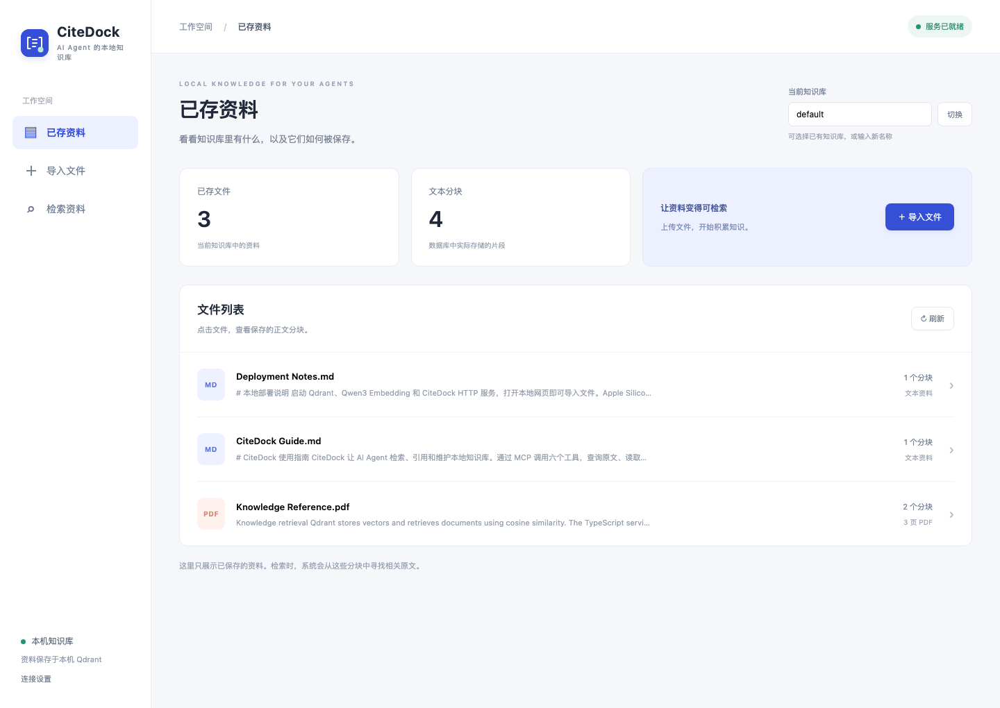
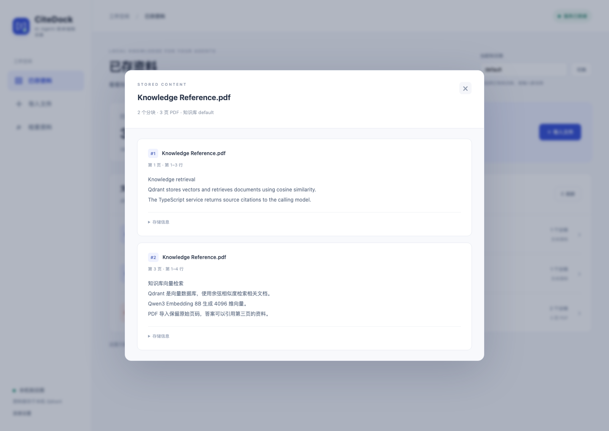
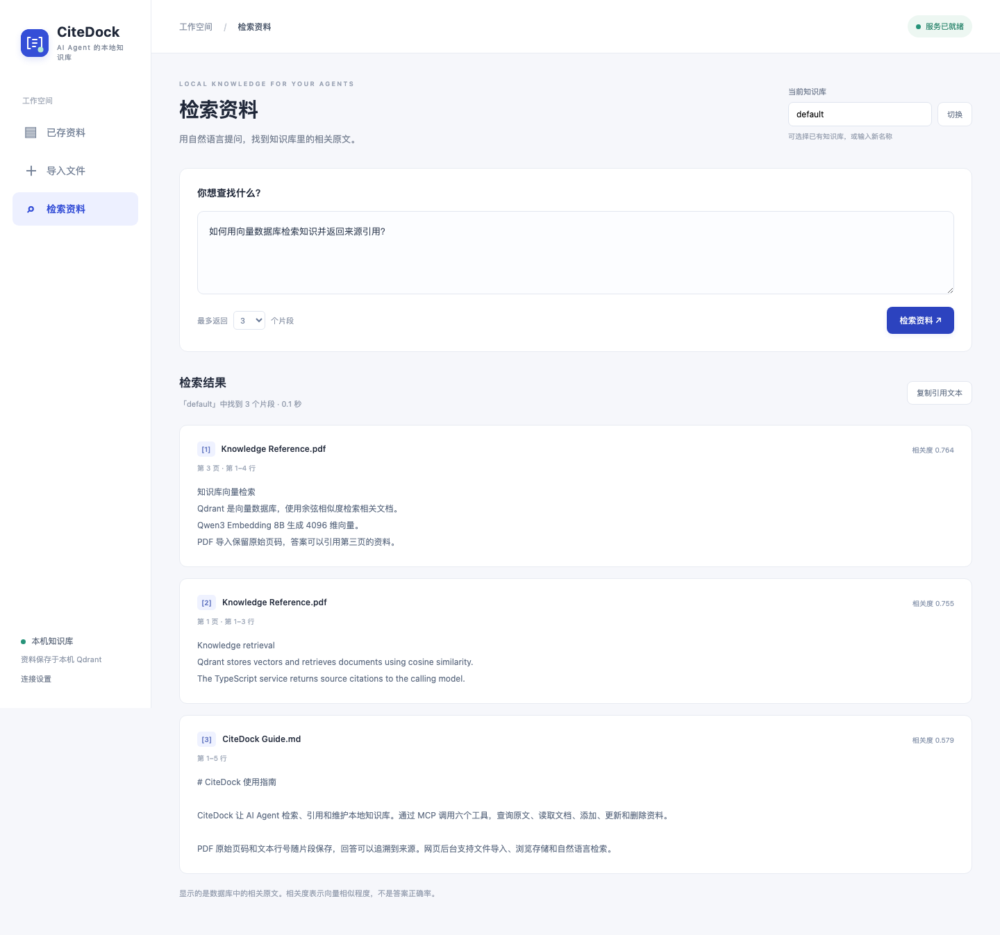

<p align="center"></p>

# CiteDock

**A local knowledge base your AI agents can search, cite, and maintain.**

[中文](README.zh-CN.md) · [Configuration](docs/configuration.md) · [Tool reference](docs/tools.md) · [Benchmarks](docs/benchmarks.md)

Turn PDFs, Markdown, and notes into knowledge your agents can use. CiteDock exposes six MCP tools to search, read, add, update, and delete documents, with a web dashboard to inspect what is actually stored in Qdrant.

Built with **TypeScript + Qdrant + Qwen3 Embedding**. Run embeddings locally on Apple Silicon with MLX, or connect Ollama or an OpenAI-compatible embedding service.



## What you can do

- **Give agents a working knowledge base.** Six tools cover search, document listing, reading, and document CRUD.
- **Trace answers to their sources.** Search returns passages, citation markers, line numbers, and original PDF page numbers.
- **Inspect your data.** Upload files, browse stored documents and chunks, and search from the web dashboard.
- **Keep retrieval local.** The default stack runs on your machine without a hosted model API.
- **Integrate your way.** Use MCP stdio, HTTP function calling, the TypeScript SDK, or the CLI.

CiteDock returns evidence. The calling language model uses that evidence to write an answer.

<details>
<summary>See PDF page citations and retrieval results</summary>





</details>

## Quick start — Apple Silicon

Requirements: **Node.js 22.13+**, npm, **Python 3.11+**, and **macOS 26+** for the pinned MLX dependencies. The default model downloads approximately **4.26 GB** of weights on first run. Our local measurements used an Apple M5 with 24 GiB memory.

From a cloned or downloaded copy of this repository:

```bash
npm ci
cp .env.example .env
npm run build
```

Start these in three separate terminals:

```bash
# Terminal 1: Qdrant, with data persisted under storage/qdrant
npm run qdrant

# Terminal 2: local Qwen3 embeddings; wait for "MLX embeddings ready"
npm run mlx

# Terminal 3: web dashboard and HTTP API
npm start
```

Open **[http://127.0.0.1:3000](http://127.0.0.1:3000)**. Use **导入文件** to upload a PDF, Markdown, or TXT file, **已存资料** to inspect stored data, and **检索资料** to search. The dashboard currently uses Chinese labels.

Or try the included sample:

```bash
npm run rag -- ingest examples/knowledge.md
npm run rag -- search "How does CiteDock preserve PDF citations?"
```

On other platforms, use `docker compose up -d` for Qdrant and configure [Ollama](docs/configuration.md#ollama) or an [OpenAI-compatible service](docs/configuration.md#openai-compatible-services). The HTTP service, CLI, and MCP server do not require MLX.

## Connect an AI agent

Build the project, keep Qdrant and your embedding service running, then add this configuration to a client that supports **MCP stdio**:

```json
{
  "mcpServers": {
    "citedock": {
      "command": "node",
      "args": ["/ABSOLUTE/PATH/TO/citedock/dist/mcp.js"]
    }
  }
}
```

Replace the path with your checkout's absolute path. Desktop clients may also need the absolute path to Node. CiteDock loads `.env` from the project root even when the client starts it from another directory. The web server is optional for MCP.

Try asking your agent:

> Search my knowledge base for the deployment requirements. Cite the relevant sources.
>
> Save these meeting notes as meeting-notes.md in the default knowledge base.

| Tool                  | Purpose                                      |
| --------------------- | -------------------------------------------- |
| `rag_search`          | Retrieve evidence and citations              |
| `rag_list_documents`  | List documents and their exact source IDs    |
| `rag_get_document`    | Read document chunks with pagination         |
| `rag_add_document`    | Add a new text document                      |
| `rag_update_document` | Replace an existing document's complete text |
| `rag_delete_document` | Delete one document and all its chunks       |

Write tools require an explicit `namespace` and `source`. Updates take the complete replacement text. See the [tool reference](docs/tools.md) for pagination, metadata, and write semantics.

### HTTP and function calling

```bash
curl http://127.0.0.1:3000/v1/tools

curl http://127.0.0.1:3000/v1/tools/call \
  -H 'Content-Type: application/json' \
  -d '{"name":"rag_search","arguments":{"query":"How are PDFs imported?","namespace":"default"}}'
```

Give the definitions to your model, execute the tool call it requests, and send the result back with the original tool call ID. See [the function-calling example](examples/function-calling.ts).

The HTTP API is a function-calling adapter; MCP currently uses stdio.

### TypeScript SDK

From a script at the repository root:

```ts
import { createRagService, executeTool, ragTools } from "./dist/index.js";

const rag = createRagService();
// Send ragTools to your model, then dispatch its requested call:
const result = await executeTool(rag, "rag_search", {
  query: "What are the deployment requirements?",
  namespace: "default",
});
console.log(result.context);
```

The package is currently used from source; it is not published to npm.

## Embedding options

| Runtime           | Configuration                            | Use case                                    |
| ----------------- | ---------------------------------------- | ------------------------------------------- |
| MLX               | Default local OpenAI-compatible endpoint | Apple Silicon; pinned Qwen3 8B 4-bit model  |
| Ollama            | `EMBEDDING_PROVIDER=ollama`              | An existing local Ollama installation       |
| OpenAI-compatible | `EMBEDDING_PROVIDER=openai`              | Your own local or hosted embedding endpoint |

The default uses 4096-dimensional vectors and cosine similarity. When changing the model, provider, or dimensions, use a new Qdrant collection and re-import your documents. See [configuration](docs/configuration.md).

## Project status

CiteDock is an early **0.1.0** project. It supports UTF-8 text, Markdown, and PDFs with a text layer. Scanned PDFs are rejected; OCR is not implemented. Document updates replace complete text, and writes are serialized per document within one process.

We compared the default 4-bit model with the original BF16 weights on the full Chinese STSB test split and BEIR SciFact test queries. The results were close on these two datasets; this is not a full MTEB evaluation or a guarantee for every task. [Read the measurements and method](docs/benchmarks.md).

## Documentation and contributions

- [Configuration and troubleshooting](docs/configuration.md)
- [MCP, HTTP, and SDK reference](docs/tools.md)
- [Source layout and development](docs/development.md)
- [完整中文使用指南](docs/guide.zh-CN.md)
- [Embedding benchmark record](docs/benchmarks.md)
- [Contributing](CONTRIBUTING.md) · [Security](SECURITY.md) · [Changelog](CHANGELOG.md)

If CiteDock helps your agents work with local knowledge, a star helps others discover it. Bug reports, reproducible evaluations, and contributions are welcome.

## License

[MIT](LICENSE). Dependencies and model weights have their own licenses. This repository does not include model weights or your imported documents.
