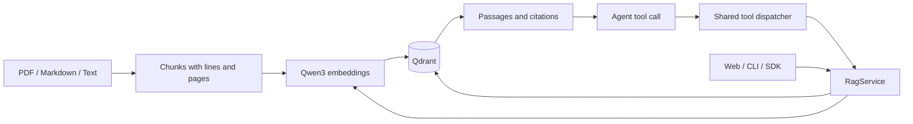

# Development

[Home](../README.md) · [Contributing](../CONTRIBUTING.md)

## Source layout

| Path                                | Responsibility                                            |
| ----------------------------------- | --------------------------------------------------------- |
| `src/config.ts`                     | Environment loading and validation                        |
| `src/files.ts`, `src/pdf.ts`        | File traversal and PDF text extraction                    |
| `src/chunker.ts`                    | Unicode-aware splitting and original positions            |
| `src/embedding.ts`                  | Qwen query instructions and embedding providers           |
| `src/store.ts`                      | Qdrant collections, persistence, browsing, and search     |
| `src/rag.ts`                        | Ingestion, retrieval, document CRUD, and write sequencing |
| `src/tools.ts`, `src/schema.ts`     | Shared tool contracts and validation                      |
| `src/mcp-server.ts`, `src/mcp.ts`   | MCP stdio server                                          |
| `src/http-server.ts`, `src/http.ts` | HTTP API and process entry point                          |
| `src/cli.ts`, `src/index.ts`        | CLI and public SDK                                        |
| `web/`, `src/web-assets.ts`         | Dashboard and explicit static asset routes                |
| `scripts/mlx_embedding_server.py`   | Local MLX inference service                               |
| `scripts/*-local.sh`                | Local service setup and launch helpers                    |
| `test/`                             | Unit, contract, and optional live integration tests       |

## Data flow



Qdrant stores vectors and chunk payloads. Browsing reads payloads without computing embeddings. Search embeds the question, performs cosine retrieval, and builds cited context. Add and update embed complete replacement text before writing; delete removes the exact document without an embedding request.

A document is identified by its namespace and source. Namespaces organize data within a collection. One collection must use one embedding configuration. The original PDF binary is not stored.

## Commands

```bash
npm ci
npm run check
npm run dev
```

`check` runs TypeScript validation, builds the backend and dashboard, and runs the Node test suite. Tests use controlled dependencies and do not require downloading model weights. Some HTTP tests bind loopback ports.

`dev` compiles web TypeScript once and watches the HTTP backend. Rebuild or restart after changing web TypeScript. For backend debugging, use the included VS Code launch configurations.

Optional live checks, with Qdrant and embeddings running:

```bash
npm run build
npm run test:live
```

The live suite uses an isolated temporary collection and deletes it afterward. It exercises actual embeddings, Qdrant, CLI/HTTP PDF imports, citations, replacement, namespace isolation, and MCP launched from another working directory.

MLX contract tests require the helper's local virtual environment:

```bash
npm run test:mlx
```

These Python tests check server contracts; they are separate from the optional live model integration.

## Protocol boundaries

MCP stdout is JSON-RPC transport; logs belong on stderr. HTTP function-calling definitions share the same dispatcher and schemas. The current MCP transport is stdio; the HTTP API does not implement MCP Streamable HTTP.

Per-document write sequencing belongs to a `RagService` instance. It does not coordinate independent processes or turn multiple Qdrant operations into a transaction. Keep those limits in mind when changing ingestion or CRUD behavior.
